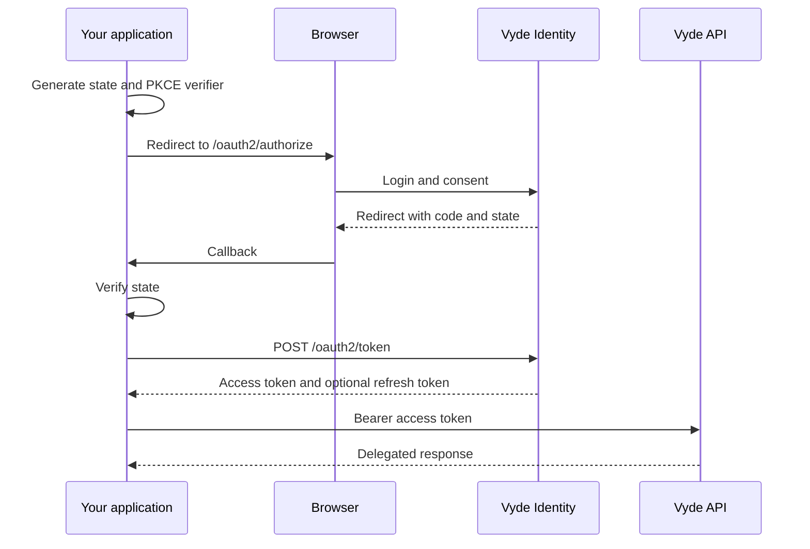

This guide implements the same server-side login with copy-ready examples. The application stores
a short-lived `state` and PKCE verifier, redirects to Vyde, exchanges the callback code, and calls
its API.

## The protocol



## Conventions

- Use Authorization Code + PKCE. Do not use password grants.
- Generate cryptographically random `state` and bind it to the browser session.
- Compare callback `state` before exchanging the code.
- Keep client secrets, access tokens and refresh tokens on the server.
- Register exact redirect URIs; do not use wildcards.
- Request the smallest scope set. Add `openid` only for OIDC.
- Rotate refresh tokens atomically and treat reuse as a security event.
- Discover endpoints from `/.well-known/openid-configuration` in production code.

## Start the authorization request

Generate `state` and the PKCE verifier with your framework, store both in the user's server-side
login transaction, and redirect the browser to the resulting URL.

import { Tabs, TabItem } from '@astrojs/starlight/components';

<Tabs>
<TabItem label="TypeScript">

```ts
import crypto from 'node:crypto';

const state = crypto.randomBytes(32).toString('base64url');
const verifier = crypto.randomBytes(32).toString('base64url');
const challenge = crypto.createHash('sha256').update(verifier).digest('base64url');
const params = new URLSearchParams({
  response_type: 'code',
  client_id: process.env.VYDE_CLIENT_ID!,
  redirect_uri: 'https://app.example.com/oauth/callback',
  scope: 'openid profile email',
  state,
  code_challenge: challenge,
  code_challenge_method: 'S256',
});
const authorizationUrl = `https://identity.vyde.dev/oauth2/authorize?${params}`;
```

</TabItem>
<TabItem label="Python">

```python
import base64, hashlib, os, secrets
from urllib.parse import urlencode

state = secrets.token_urlsafe(32)
verifier = secrets.token_urlsafe(32)
challenge = base64.urlsafe_b64encode(
    hashlib.sha256(verifier.encode()).digest()
).rstrip(b"=").decode()
authorization_url = "https://identity.vyde.dev/oauth2/authorize?" + urlencode({
    "response_type": "code",
    "client_id": os.environ["VYDE_CLIENT_ID"],
    "redirect_uri": "https://app.example.com/oauth/callback",
    "scope": "openid profile email",
    "state": state,
    "code_challenge": challenge,
    "code_challenge_method": "S256",
})
```

</TabItem>
<TabItem label="Rust">

```rust
use base64::{engine::general_purpose::URL_SAFE_NO_PAD, Engine};
use rand::RngCore;
use sha2::{Digest, Sha256};

let mut bytes = [0u8; 32];
rand::thread_rng().fill_bytes(&mut bytes);
let state = URL_SAFE_NO_PAD.encode(bytes);
rand::thread_rng().fill_bytes(&mut bytes);
let verifier = URL_SAFE_NO_PAD.encode(bytes);
let challenge = URL_SAFE_NO_PAD.encode(Sha256::digest(verifier.as_bytes()));
let authorization_url = format!(
    "https://identity.vyde.dev/oauth2/authorize?response_type=code&client_id={client_id}&\
     redirect_uri={redirect_uri}&scope=openid%20profile%20email&state={state}&\
     code_challenge={challenge}&code_challenge_method=S256"
);
```

</TabItem>
<TabItem label="cURL">

```bash
curl -G 'https://identity.vyde.dev/oauth2/authorize' \
  --data-urlencode 'response_type=code' \
  --data-urlencode 'client_id=YOUR_CLIENT_ID' \
  --data-urlencode 'redirect_uri=https://app.example.com/oauth/callback' \
  --data-urlencode 'scope=openid profile email' \
  --data-urlencode 'state=RANDOM_STATE' \
  --data-urlencode 'code_challenge=BASE64URL_SHA256_VERIFIER' \
  --data-urlencode 'code_challenge_method=S256'
```

</TabItem>
</Tabs>

At the callback, compare `state` with the value stored in the login transaction before exchanging
the code. Keep the verifier until the exchange completes.

## Exchange the code

Use the same tabbed example for the token request. Send the client secret only from a backend
when the application is confidential; public clients use PKCE without a secret.

<Tabs>
<TabItem label="TypeScript">

```ts
const response = await fetch('https://identity.vyde.dev/oauth2/token', {
  method: 'POST',
  headers: { 'content-type': 'application/x-www-form-urlencoded' },
  body: new URLSearchParams({
    grant_type: 'authorization_code',
    client_id: process.env.VYDE_CLIENT_ID!,
    code,
    redirect_uri: 'https://app.example.com/oauth/callback',
    code_verifier: verifier,
  }),
});
const tokens = await response.json();
```

</TabItem>
<TabItem label="Python">

```python
import requests

tokens = requests.post("https://identity.vyde.dev/oauth2/token", data={
    "grant_type": "authorization_code",
    "client_id": os.environ["VYDE_CLIENT_ID"],
    "code": code,
    "redirect_uri": "https://app.example.com/oauth/callback",
    "code_verifier": verifier,
}, timeout=10).json()
```

</TabItem>
<TabItem label="Rust">

```rust
let tokens = reqwest::Client::new()
    .post("https://identity.vyde.dev/oauth2/token")
    .form(&[
        ("grant_type", "authorization_code"),
        ("client_id", client_id),
        ("code", code),
        ("redirect_uri", redirect_uri),
        ("code_verifier", verifier),
    ])
    .send()
    .await?
    .error_for_status()?
    .json::<TokenResponse>()
    .await?;
```

</TabItem>
<TabItem label="cURL">

```bash
curl -X POST 'https://identity.vyde.dev/oauth2/token' \
  -H 'content-type: application/x-www-form-urlencoded' \
  --data-urlencode 'grant_type=authorization_code' \
  --data-urlencode 'client_id=YOUR_CLIENT_ID' \
  --data-urlencode 'code=AUTHORIZATION_CODE' \
  --data-urlencode 'redirect_uri=https://app.example.com/oauth/callback' \
  --data-urlencode 'code_verifier=PKCE_VERIFIER'
```

</TabItem>
</Tabs>

## What success looks like

The token response contains an access token, its type and expiry, the granted scope, and an ID token
when `openid` was granted. Store refresh tokens only when `offline_access` was requested.
