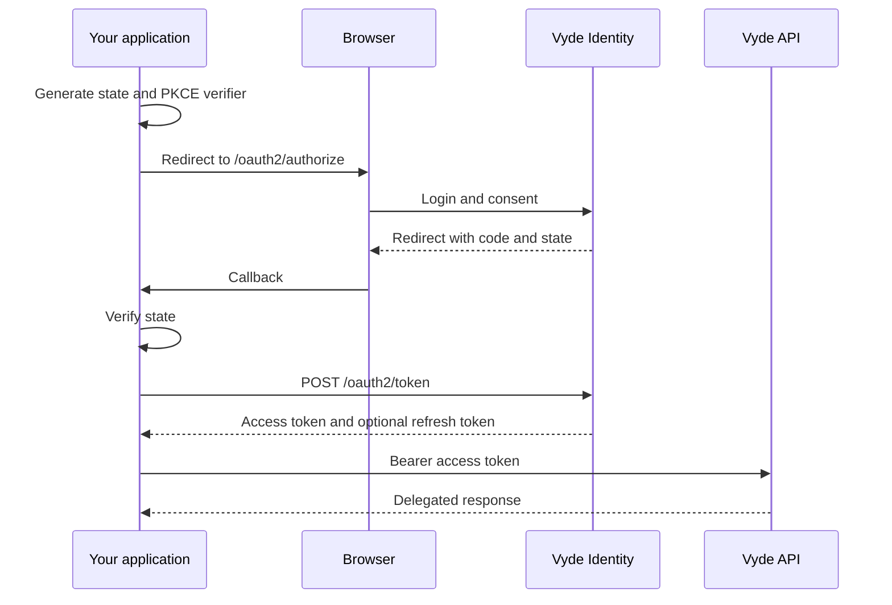

This guide implements the same server-side login in three languages. The application stores a
short-lived `state` and PKCE verifier, redirects to Vyde, exchanges the callback code, and calls
its API.

## The protocol



## Conventions

- Use Authorization Code + PKCE. Do not use password grants.
- Generate cryptographically random `state` and bind it to the browser session.
- Compare callback `state` before exchanging the code.
- Keep client secrets, access tokens and refresh tokens on the server.
- Register exact redirect URIs; do not use wildcards.
- Request the smallest scope set. Add `openid` only for OIDC.
- Rotate refresh tokens atomically and treat reuse as a security event.
- Discover endpoints from `/.well-known/openid-configuration` in production code.

## TypeScript

```ts
import crypto from 'node:crypto';
import express from 'express';

const app = express();
const identity = 'https://identity.vyde.dev';
const clientId = process.env.VYDE_CLIENT_ID!;
const redirectUri = 'https://app.example.com/oauth/callback';

app.get('/login', (req, res) => {
  const state = crypto.randomBytes(32).toString('base64url');
  const verifier = crypto.randomBytes(32).toString('base64url');
  const challenge = crypto.createHash('sha256').update(verifier).digest('base64url');
  // Store state and verifier in the user's server-side login transaction.
  const params = new URLSearchParams({
    response_type: 'code', client_id: clientId, redirect_uri: redirectUri,
    scope: 'openid profile email', state,
    code_challenge: challenge, code_challenge_method: 'S256',
  });
  res.redirect(`${identity}/oauth2/authorize?${params}`);
});
```

At the callback, verify the stored state and exchange the code with `fetch`. Send the client secret
only from your backend when the application is confidential.

## Python

```python
import base64, hashlib, secrets
from urllib.parse import urlencode

identity = "https://identity.vyde.dev"
client_id = os.environ["VYDE_CLIENT_ID"]
redirect_uri = "https://app.example.com/oauth/callback"
state = secrets.token_urlsafe(32)
verifier = secrets.token_urlsafe(32)
challenge = base64.urlsafe_b64encode(
    hashlib.sha256(verifier.encode()).digest()
).rstrip(b"=").decode()

login_url = identity + "/oauth2/authorize?" + urlencode({
    "response_type": "code", "client_id": client_id,
    "redirect_uri": redirect_uri, "scope": "openid profile email",
    "state": state, "code_challenge": challenge,
    "code_challenge_method": "S256",
})
```

Store `state` and `verifier` in a server-side session, verify the callback state, then use
`requests.post(..., data={...})` against `/oauth2/token`.

## Rust

```rust
use base64::{engine::general_purpose::URL_SAFE_NO_PAD, Engine};
use rand::RngCore;
use sha2::{Digest, Sha256};

let mut bytes = [0u8; 32];
rand::thread_rng().fill_bytes(&mut bytes);
let verifier = URL_SAFE_NO_PAD.encode(bytes);
let challenge = URL_SAFE_NO_PAD.encode(Sha256::digest(verifier.as_bytes()));
let state = URL_SAFE_NO_PAD.encode(bytes);
let authorization_url = format!(
    "https://identity.vyde.dev/oauth2/authorize?response_type=code&client_id={client_id}&\
     redirect_uri={redirect_uri}&scope=openid%20profile%20email&state={state}&\
     code_challenge={challenge}&code_challenge_method=S256"
);
```

Use `reqwest` to post form data to `/oauth2/token`, and keep the verifier until the exchange.

## What success looks like

The token response contains an access token, its type and expiry, the granted scope, and an ID token
when `openid` was granted. Store refresh tokens only when `offline_access` was requested.
